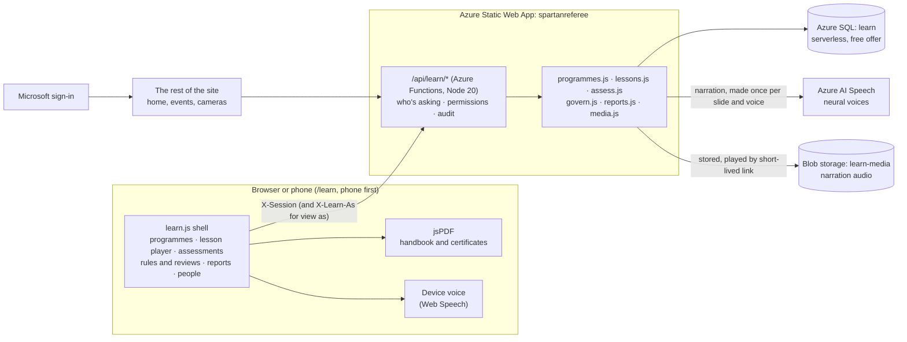

# Architecture

The learning platform is an area of the existing SpartanReferee site: the same Static Web App, the same Microsoft sign-in, the same API. Its records are in their own relational database, so camera booking, judging and the servers carry on exactly as before (the brief, section 8: no change to the capture and AI code).

## Requests

Every request to `/api/learn/...` goes through `api/src/learn/index.js`:

1. **Who's asking**: the session (Microsoft sign-in) is mapped to a person through `person_login`. Only people in the organisation get in: the site's admins (as global admins) and the referees on its list (as learners). Someone taken off the list loses access at once.
2. **View as**: an admin may send `X-Learn-As` with an invented person's id; every check then uses that person's roles, and the audit log records both.
3. **Permissions** (`permissions.js`): one function, `can(grants, action, { programmeId, regionId, personId, selfId })`, asked before every read and write. Roles are global admin, programme owner, regional coordinator, content editor, assessor, technical admin; everyone is a learner for themselves.
4. **The areas**, each a module sharing one context and adding hooks to the others: programmes (catalogue, versions, curriculum, enrolment), lessons (content versions, completions, media), assess (questions, attempts, credentials), govern (rules, review items, handbook), reports (dashboards, export, read API).
5. **Audit**: every privileged change writes an `audit_event` row in the same transaction, with a correlation id.

## Data model

One person is shared; everything about learning belongs to a programme version (the brief's section 7).

| Table | What it holds | Scope |
|---|---|---|
| `person`, `person_login`, `region` | the global profile (UUID and SR number), how they sign in, regions | shared |
| `role_grant` | admin roles, optionally for one programme or region | shared |
| `duplicate_flag` | possible duplicates, for review (never merged automatically) | shared |
| `programme`, `programme_version` | each programme, its versions and their pass policy (pass mark, attempts, wait, validity) | per programme |
| `module`, `lesson` | the curriculum of a version; `lineage_id` and `code` follow a module or lesson across versions | per version |
| `programme_role`, `enrolment` | what someone is in a programme (role, grade), and their enrolment on a version | per person and programme |
| `content_version` | a lesson's content in one language, versioned, with its approval, source hash and (translations) the English it translates | per lesson and language |
| `lesson_progress`, `completion` | the bookmark; completions with the exact content version, language and whether it was a preview translation | per person |
| `media_config`, `media_asset` | which media provider plays lessons, and narration already made | per programme |
| `assessment`, `question` | each version's question bank, with rule references and review notes | per version |
| `attempt` | every attempt: the answers with each question's lineage, version and rules, score, result, assessor's decision | per person |
| `credential` | demonstration credentials, with expiry and status | per person and programme |
| `rule_document`, `rule_ref`, `rule_link` | source documents, versioned rule references, what cites each | per programme |
| `review_item` | rule changes (with what they affect) and disputes | per programme |
| `audit_event` | every privileged change, append only | shared |

Published versions (programmes, content, questions, rules) never change: a change is a new version, approved by someone other than its author.

## The page

`/learn/` is one page; the part after `#` picks the view. `learn.js` is the shell (sign-in, header, view as, routing); each area is a module exporting its views and a `wire()` (`programmes.js`, `people.js`, `cameras.js`, `lesson.js`, `assess.js`, `govern.js`, `reports.js`), sharing `core.js`. It is phone first: every page is checked at 320, 360 and 390 pixels wide (`scripts/mobile-check.mjs`).

## Integration boundary

Other systems (event assignment, live officiating, AI review) can later read a person, their enrolments and credentials, and the current version of a rule through the versioned read API ([api.md](api.md)). Nothing here manages events or officiating.
